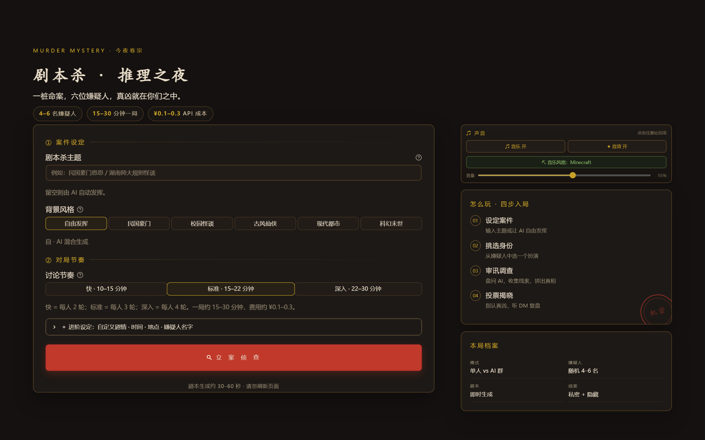
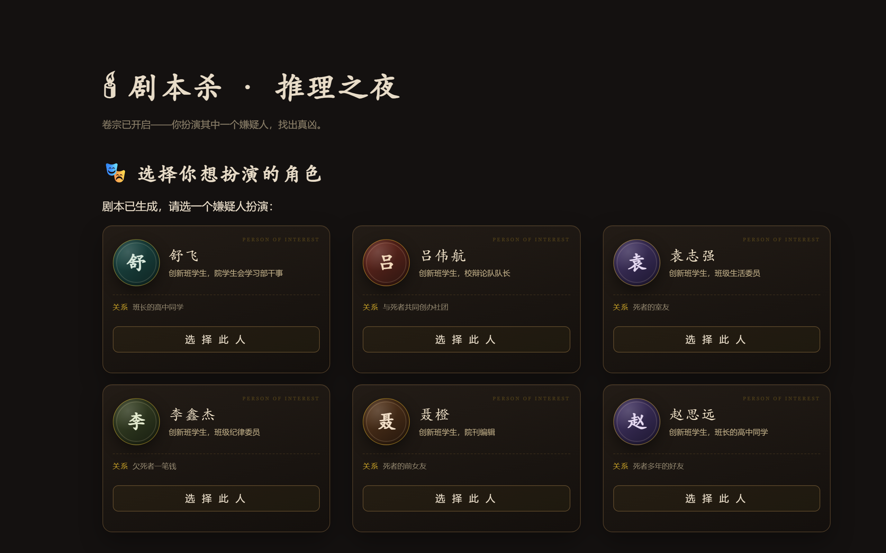
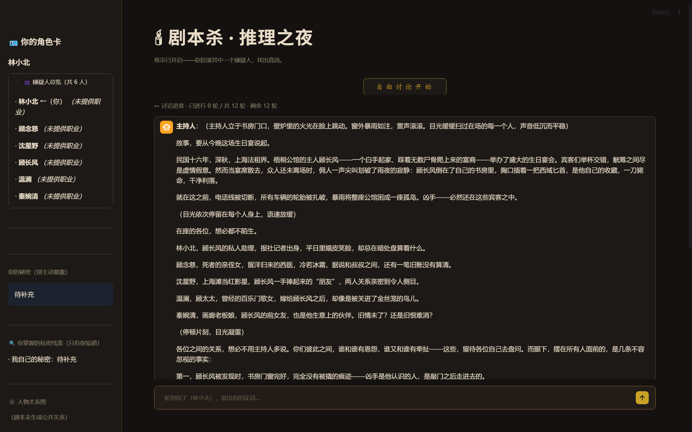
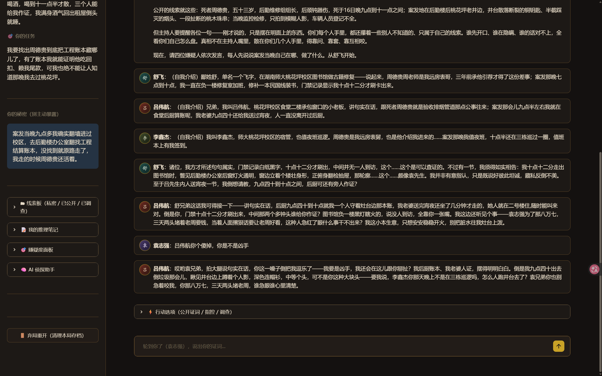
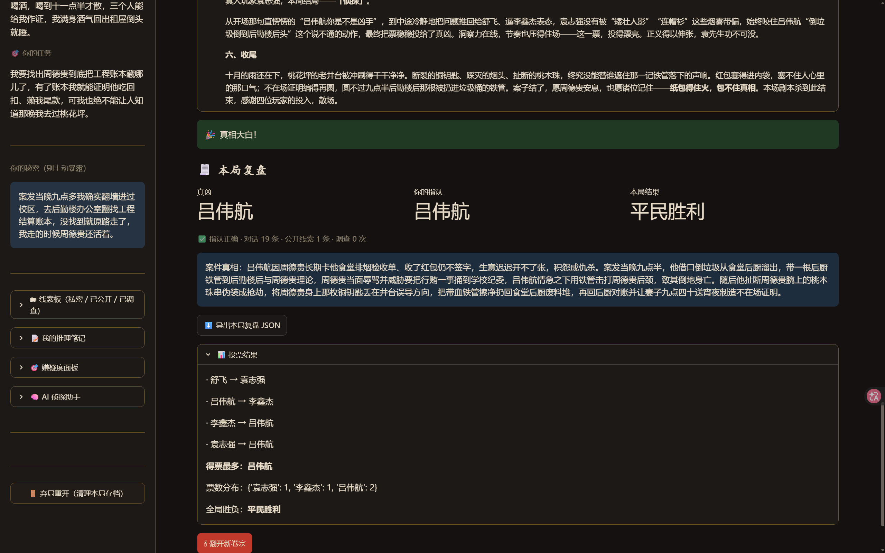

# 🎭 剧本杀 · 推理之夜

> **LangGraph 多智能体 + 人在回路（Human-in-the-Loop）的 AI 剧本杀主持人**

一个**能自己开剧本杀的 AI 主持人**：你输入主题和风格，它自动创作案件、设计嫌疑人、分配线索；然后你扮演其中一个嫌疑人，和一群 AI 同台辩论、推理、投票、抓出真凶。

LLM 只负责“说什么”，Python 规则层负责“算不算、合不合规”。项目不是“AI 跑一局”的演示，而是有完整信息差、角色剧本、防剧透校验、计票机制、人在回路和复盘导出的可玩实现。

---

## 📖 目录

- [项目亮点](#-项目亮点)
- [效果展示](#-效果展示)
- [智能体架构](#-智能体架构)
- [信息差与核心机制](#-信息差与核心机制)
- [技术栈](#-技术栈)
- [快速开始](#-快速开始)
- [怎么玩一局](#-怎么玩一局)
- [项目结构](#-项目结构)
- [测试与质量](#-测试与质量)
- [配置说明](#-配置说明)
- [性能、限制与路线图](#-性能限制与路线图)
- [FAQ](#-faq)
- [致谢与许可](#-致谢与许可)

---

## ✨ 项目亮点

- **真正的多智能体**：DM 主持人、多个 AI 嫌疑人、人类玩家三种角色共同推进一局游戏。
- **人在回路**：选角、发言、投票、平票最后陈述都通过 LangGraph interrupt 暂停，等待玩家输入。
- **信息差**：公开线索 / 私密线索 / 隐藏线索三层结构，AI 不能读取别人的剧本和秘密。
- **可解释推理**：AI 先产生 think 内心推理，再输出 speak 公开发言；内心戏不展示给玩家。
- **确定性规则层**：计票、校验、防剧透、名单过滤全部是 Python 纯函数，不依赖 LLM。
- **可测试**：172 个测试全部不调用真实 API；另有 fake-LLM 图级端到端冒烟测试。
- **完整 UI**：启动封面、开始页、角色卡、搜证、聊天、投票、胜负动画、复盘导出。
- **可玩性增强**：AI 侦探助手、场景搜证、嫌疑度面板、推理笔记、最近战绩。

---

## 📸 效果展示

| 启动封面（深夜档案室） | 开始页（主题 / 风格 / 节奏） |
|:---:|:---:|
|  |  |

| 选角（首字头像 + 公开身份） | 主持人开场（角色卡 + 故事） |
|:---:|:---:|
|  |  |

| 讨论与搜证 | 真相揭晓与复盘 |
|:---:|:---:|
|  |  |

整体视觉是暗色档案风：**#141110 黑底 + 金红配色 + 火漆印章 + 打字机 + 阶段幕布 + 原创生成式 BGM**。沉浸感是加分项，下面是主菜：智能体架构。

---

## 🧠 智能体架构

整个游戏跑在 LangGraph 的 **StateGraph** 上，共 **15 个节点**。核心流程：

~~~mermaid
flowchart TD
    A[用户输入主题/风格] --> B[generate_script]
    B --> C[distribute_clues]
    C --> D[choose_role interrupt 选角]
    D --> E[dm_intro]
    E --> F[self_intro]
    F --> G{route_speaker}
    G -->|玩家| H[human_turn]
    G -->|AI| I[ai_player_turn]
    G -->|中场| J[dm_midpoint]
    H --> G
    I --> G
    J --> G
    G -->|投票| K[ai_vote]
    K --> L[human_vote interrupt]
    L --> M[tally]
    M -->|平票| N[tie_break]
    N --> O[human_tiebreak]
    O --> K
    M -->|结束| P[final_statement]
    P --> Q[dm_reveal]
    Q --> R[END]
~~~

**关键设计**：

| 设计 | 实现 | 价值 |
|---|---|---|
| 多角色 Agent | DM / AI 嫌疑人 / 玩家 | 每个角色有独立身份、秘密、任务和发言风格 |
| 角色记忆 | GameState.agent_memory + 最近发言窗口 | 降低 AI 自相矛盾，控制 token 成本 |
| 人在回路 | interrupt + Command(resume) | 玩家真正参与选角、发言、投票、平票辩护 |
| 状态持久化 | MemorySaver；可选 SqliteSaver | 支持 rerun、暂停和恢复 |
| 确定性规则 | rules.py / validators.py | 计票、校验、防泄露不交给 LLM |
| 防剧透 | 私密线索隔离 + prompt 隔离 + 输出检查 | AI 不直接读取或复述凶手真相 |

---

## 🔍 信息差与核心机制

### 三层线索

| 层级 | 谁能看到 | 例子 |
|---|---|---|
| 公开线索 public_clues | 所有人 | 现场发现的可公开物证 |
| 私密线索 private_clues | 只有持有者 | 角色自己的秘密、把柄、目击信息 |
| 隐藏线索 hidden_clues | 调查后才发现 | 现场搜证才能获得的补充证据 |

### 核心机制

- **Think / Speak 双通道**：AI 先内心推理，再公开发言；页面只展示 speak。
- **剧本自洽校验**：生成后检查角色字段、公开关系、死者关系、凶手与线索链路，不合格自动重试。
- **凶手狡辩策略池**：按被指控次数轮换否认、反问、嫁祸策略，避免凶手轻易自爆。
- **平票加时**：AI 候选人先辩护；玩家若在平票名单，也有最后陈述机会。
- **本局复盘**：真凶 / 你的指认 / 票数 / 线索统计 / 真相摘要 / JSON 导出。
- **AI 侦探助手**：只读取公开线索 + 玩家笔记，给可疑点和下一步盘问建议，不读取私密线索或真相。
- **场景搜证**：隐藏线索按书房 / 花园 / 门厅分配，玩家可选择地点调查；旧剧本自动回退随机调查。
- **玩家侧推理工具**：推理笔记、嫌疑度面板、线索板；这些数据不进入 AI 上下文。

---

## 🛠️ 技术栈

| 类别 | 选型 | 用途 |
|---|---|---|
| 智能体编排 | LangGraph ≥1.0 | StateGraph、条件边、interrupt、checkpointer |
| 大模型 | DeepSeek deepseek-flash | 中文生成稳、成本低，每局约 ¥0.1–0.3 |
| Web UI | Streamlit ≥1.61 | 单文件页面编排 + 暗色主题 + 会话状态 |
| 声音 | Web Audio API | 纯代码生成 BGM / 事件音效，无外部音频素材 |
| 关系数据 | Python dict / TypedDict | 人物关系参与 prompt 与个人剧本，不做前端关系图 |
| 测试 | pytest | 纯函数测试 + fake-LLM 图级烟测 |
| 静态检查 | ruff | E/W/F/I/B 规则集 |
| CI | GitHub Actions | Python 3.10 + 3.12，无真实 API 调用 |

---

## 🚀 快速开始

### 环境要求

- Python **3.10+**
- 一个 DeepSeek API Key（生成剧本需要）
- Windows / macOS / Linux 均可

### 1. 创建环境

~~~bash
conda create -n py10 python=3.10 -y
conda activate py10
~~~

### 2. 安装依赖

~~~bash
pip install -r requirements.txt -i https://pypi.tuna.tsinghua.edu.cn/simple
~~~

想严格复现实装环境：

~~~bash
pip install -r requirements.lock -i https://pypi.tuna.tsinghua.edu.cn/simple
~~~

requirements.txt 是兼容区间；requirements.lock 是精确版本。streamlit 下限必须 ≥1.61，因为主题选择器与 st.iframe 行为按 1.61 校准。

### 3. 配置 API Key

~~~bash
cp .env.example .env
# Windows PowerShell: Copy-Item .env.example .env
~~~

编辑 .env：

~~~dotenv
DEEPSEEK_API_KEY=你的key
DEEPSEEK_MODEL=deepseek-flash
~~~

到 [platform.deepseek.com](https://platform.deepseek.com) 注册并创建 key；每局成本约 ¥0.1–0.3。

### 4. 启动

~~~bash
# Web 版（推荐）
streamlit run app.py
# 浏览器打开 http://localhost:8501

# 终端版
python main.py
~~~

**VS Code 快速启动**：用 VS Code 打开 Agent_Developing 仓库根目录（不是上一级课程目录），新建集成终端会自动激活 Conda py10，直接执行 streamlit run app.py。修改 .vscode/settings.json 后需要关闭旧终端或重启 VS Code。

---

## 🎮 怎么玩一局

1. **启动封面**：点击「开始游戏」。
2. **案件设定**：输入主题，选择背景风格和节奏；可展开填写自定义剧情、时间、地点、嫌疑人名字。
3. **生成剧本**：等待 30–60 秒，页面只显示阶段进度，不泄露凶手/真相 token。
4. **选择角色**：从 4–6 名嫌疑人中选一个；其他角色由 AI 扮演。
5. **阅读个人剧本**：查看身份、秘密、与死者关系、私密线索和本局任务。
6. **讨论 / 搜证 / 指控**：发言、公开线索、调查地点、指控嫌疑人，或保持沉默。
7. **投票**：可弃权；平票时 AI 候选人先辩护，玩家在名单中可做最后陈述。
8. **真相与复盘**：DM 揭晓真相，查看胜负动画、本局复盘卡、票数分布，并可导出 JSON。

一局约 **10–30 分钟**，取决于人数与节奏。

---

## 🗂️ 项目结构

~~~text
Agent_Developing/
├── app.py                 # Streamlit Web UI（页面编排）
├── ui_theme.py            # 全局暗色主题 CSS
├── ui_assets.py           # 开场动画 / 阶段幕布 HTML
├── ui_audio.py            # 生成式 BGM + 事件音效 + 控制面板
├── ui_launch.py           # 首次启动的沉浸式封面
├── ui_characters.py       # 首字头像 / 选角卡 / 角色卡
├── ui_start.py            # 开始页配置与渲染
├── ui_components.py       # 生成进度 / 结算动画 / 滚动恢复
├── main.py                # 终端交互版入口
├── graph.py               # LangGraph 图编排
├── game_state.py          # TypedDict 共享状态 + reducer
├── nodes.py               # LLM 节点 + 确定性节点
├── rules.py               # 计票 / 线索 / 点名 / 结局规则
├── prompts.py             # prompt 构建与隔离
├── validators.py          # JSON 解析 / 清洗 / 兜底
├── interrupt_handler.py   # interrupt 类型识别 / 校验
├── game_session.py        # 图生命周期 + interrupt 抽象
├── locations.py           # 搜证地点映射
├── detective_assistant.py # AI 侦探助手 prompt
├── names.py               # 名字池与抽样
├── logging_config.py      # 日志轮转 + 对局 ID
├── config.py              # 环境变量与 LLM 配置
├── tests/                 # pytest（172 passed）
├── docs/
│   ├── screenshots/       # README 截图
│   ├── launch-screen-design.md
│   ├── optimization-proposal-2026-11.md
│   ├── dsh-audit-prompt-2026-11.md
│   ├── dsh-audit-report-2026-11.md
│   ├── desktop-packaging-analysis-2026-11.md
│   ├── desktop-option-a-proposal-2026-11.md
│   ├── desktop-option-c-proposal-2026-11.md
│   └── deep-review-2026-08/
├── requirements.txt       # 兼容区间
├── requirements.lock      # 精确版本
├── .streamlit/config.toml # 暗色主题 / 工具栏配置
└── .env.example           # 环境变量模板
~~~

模块边界很明确：nodes.py 只做编排（调用 LLM + 调确定性函数），游戏规则全在 rules.py / validators.py，prompt 全在 prompts.py，因此测试可以完全不依赖真实 LLM。

---

## 🧪 测试与质量

~~~bash
pytest -q -W error   # → 172 passed
ruff check .         # → All checks passed
~~~

CI 在 GitHub Actions 上跑 Python 3.10 + 3.12 两个版本，全程不请求真实 DeepSeek API。

覆盖范围：

- JSON 解析、名单过滤、线索兜底
- 剧本自洽校验（字段 / 公开关系 / 死者关系 / 凶手）
- 计票、投票校验、平局 / 弃权 / 结局判断
- 凶手狡辩策略池、2-gram 线索检测、点名追问守卫
- 平票结构化候选传递、玩家不可自投
- fake-LLM 图级端到端冒烟测试（tests/test_graph_flow.py）
- 声音系统契约（tests/test_audio.py）
- 角色视觉 / 头像 / HTML 转义（tests/test_character_ui.py）

---

## ⚙️ 配置说明

完整模板见 .env.example。常用项：

| 变量 | 默认 | 说明 |
|---|---|---|
| DEEPSEEK_API_KEY | 无（必填） | DeepSeek API Key |
| DEEPSEEK_MODEL | deepseek-flash | 模型名 |
| ROUNDS_PER_PLAYER | 3 | 每人发言轮数（UI 可按局覆盖 2/3/4） |
| INVESTIGATE_LIMIT | 2 | 每局调查次数上限 |
| MAX_CONSECUTIVE_FOLLOWUPS | 1 | 玩家连续追问上限 |
| DEV_MODE | false | 显示 AI 内心戏/状态调试，剧透风险 |
| PERSISTENT_CHECKPOINT | false | 开启 SqliteSaver 持久化对局 |
| VOTE_CONCURRENT | true | AI 自我介绍/投票线程池并发 |
| TRUST_ENV | false | 是否读取系统代理环境变量 |

注意：.env 由 config.py 在 import 时加载；修改 .env 后必须重启 Streamlit，不能只依赖热重载。

---

## 📈 性能、限制与路线图

### 当前定位

这是一个**单玩家 vs AI 群**的课程项目，重点在：

- 多智能体状态机与人在回路
- 信息差和防剧透
- 确定性规则与可测试性
- 完整可演示的 Streamlit 体验

### 当前限制

- 一局必须调用真实 LLM 生成剧本，不能完全离线。
- 单机单玩家，不支持多人局域网联机。
- 使用 Streamlit，不是 React/Three.js 前端；优先保证可维护与可演示。
- 没有外部工具/RAG；单局状态用 GameState + agent_memory + checkpointer 足够。
- 人物关系图功能已移除；人物关系仍保留在 AI prompt 和玩家个人剧本中。

### 后续路线

- **P1**：私聊套话（private_chat + interrupt）
- **P1**：预设剧本库（3 个内置案件，减少 API 等待）
- **P2**：证物出示 / 组合（参考逆转裁判式证据交互）
- **P2**：跨局战绩统计 / 回放
- **P3**：角色立绘、语音、旁观模式、React/Three.js 视觉层
- **可选**：多 LLM 适配、RAG 记忆（仅在规模变大后考虑）

更完整的对标分析见 [docs/optimization-proposal-2026-11.md](docs/optimization-proposal-2026-11.md)。

---

## 💣 工程踩坑记录

| 坑 | 现象 | 解决 |
|---|---|---|
| Streamlit 组件白底 | 输入框 / selectbox / expander 在暗色主题下有白块 | CSS 通配穿透 + 背景/阴影兜底 |
| Streamlit 热重载失效 | 改 nodes.py / app.py 后页面不刷新 | Ctrl+C 重启 |
| streamlit 命令 launcher 报错 | 环境目录改名后旧 exe 路径失效 | 重装 streamlit / pytest 重建入口 |
| st.iframe 不支持 key | 跨局动画/幕布重播异常 | HTML 拼 thread_id + 位置稳定复用 |
| .env 改了没反应 | 配置仍是默认值 | load_dotenv 放到 config.py 顶部，改完重启 |
| LLM 偷懒不填 JSON | 角色卡出现“待补充” | 5+ 条硬检测 + 重试反馈 |

---

## ❓ FAQ

| 问题 | 解答 |
|---|---|
| 一局要多少钱？ | 约 ¥0.1–0.3（DeepSeek 按 token 计费），自定义剧情/长讨论会更贵 |
| 能纯本地跑吗？ | 不能，剧本生成必须调 LLM；确定性逻辑都在本地 |
| 为什么用 DeepSeek？ | 中文生成稳、价格低，适合课程项目预算 |
| 能多人联机吗？ | 当前单玩家 vs AI；多人是后续方向 |
| 改代码不生效？ | nodes.py / prompts.py / app.py 改动需 Ctrl+C 重启 |
| 关系图去哪了？ | 已移除前端关系图；relations 仍用于 AI prompt 和个人剧本 |
| 怎么只看测试？ | pytest -q；测试不调用真实 API，零 token |

---

## 🙏 致谢与许可

- **LangGraph** 团队：状态图编程模型
- **DeepSeek**：中文大模型 API
- **Streamlit**：快速构建交互界面
- 开源社区中多智能体剧本杀/社交推理项目的产品思路参考（详见优化方案书）

本项目使用 **MIT License**，详见 [LICENSE](LICENSE)。

---

> 📅 项目周期：2026 年暑假（大一升大二）
> 👤 作者：舒飞（湖南师范大学 · 软件工程 2025 级 · 数字智能方向）
> 🎯 目标：智能体开发课程项目产出
